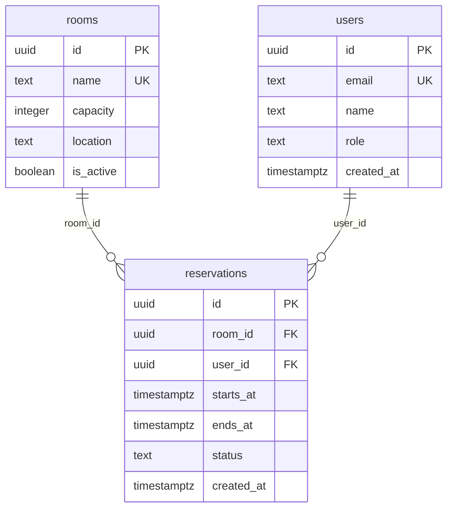
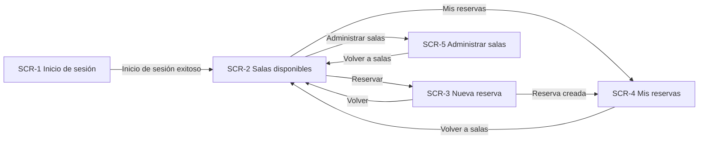

# Especificación de producto: Reserva de Salas UAI

> **Instrucciones para quien implemente.** Este documento y el documento de arquitectura son la única fuente de verdad. Implementa exactamente lo descrito: no agregues funcionalidades fuera del MVP, respeta los nombres de tablas, columnas, rutas y códigos de respuesta, y aplica todas las reglas de negocio en el backend. Los identificadores (ROLE-, FEAT-, REQ-, RULE-, EP-, SCR-) sirven para cruzar las secciones.

## 1. Problema

**Idea original:** Una app para que los estudiantes reserven salas de estudio de la biblioteca sin tener que ir al mesón.

**Problema:** Los estudiantes deben ir al mesón de la biblioteca para reservar una sala de estudio y no saben de antemano cuáles están libres.

**Contexto:** Biblioteca universitaria con 12 salas de estudio grupales, en horario de 08:00 a 21:00, de lunes a viernes.

**Mejora esperada:** Que cualquier estudiante vea la disponibilidad y reserve desde su celular en menos de un minuto, y que las salas no queden tomadas por personas ausentes.

## 2. Usuarios y roles

| Id | Rol | Descripción | Objetivos |
|---|---|---|---|
| ROLE-1 | Estudiante | Alumno regular con cuenta institucional. | Encontrar una sala libre; Reservarla rápido; Cancelar si no la usará |
| ROLE-2 | Administrador de biblioteca | Funcionario de biblioteca que gestiona las salas. | Mantener actualizado el catálogo de salas; Desactivar salas en mantención |

## 3. Resultados esperados

- El 80% de las reservas se hace desde la app durante el primer mes.
- No existen dos reservas superpuestas para la misma sala.

## 4. Alcance del MVP

### Incluido

| Id | Funcionalidad | Descripción |
|---|---|---|
| FEAT-1 | Ver disponibilidad | Ver salas y bloques libres de un día. |
| FEAT-2 | Reservar sala | Reservar un bloque libre y ver mis reservas. |
| FEAT-3 | Cancelar reserva | Cancelar una reserva propia. |
| FEAT-4 | Administrar salas | Crear, editar y desactivar salas. |

### Fuera de alcance (no implementar)

| Funcionalidad | Motivo |
|---|---|
| Recordatorios por correo | No es necesario para validar el uso. |
| Check-in con código QR | Requiere hardware en las salas. |

## 5. Recorrido principal

1. **Estudiante (ROLE-1):** Inicia sesión con su cuenta institucional. → Ve la lista de salas del día.
2. **Estudiante (ROLE-1):** Elige una fecha y revisa los bloques libres. → Ve la disponibilidad por sala.
3. **Estudiante (ROLE-1):** Selecciona sala, hora de inicio y duración, y confirma. → La reserva queda creada.
4. **Estudiante (ROLE-1):** Abre Mis reservas. → Ve su reserva y puede cancelarla.

## 6. Requisitos funcionales

| Id | Requisito | Funcionalidad | Roles |
|---|---|---|---|
| REQ-1 | Listar las salas activas con sus bloques ocupados para una fecha. | FEAT-1 (Ver disponibilidad) | Estudiante (ROLE-1), Administrador de biblioteca (ROLE-2) |
| REQ-2 | Crear una reserva para una sala, fecha, hora de inicio y fin. | FEAT-2 (Reservar sala) | Estudiante (ROLE-1) |
| REQ-3 | Listar las reservas propias futuras. | FEAT-2 (Reservar sala) | Estudiante (ROLE-1) |
| REQ-4 | Cancelar una reserva propia. | FEAT-3 (Cancelar reserva) | Estudiante (ROLE-1) |
| REQ-5 | Crear y editar salas, incluida su activación. | FEAT-4 (Administrar salas) | Administrador de biblioteca (ROLE-2) |

## 7. Reglas de negocio

- **RULE-1:** Una reserva dura entre 30 minutos y 2 horas, en múltiplos de 30 minutos.
- **RULE-2:** Dos reservas activas de la misma sala no pueden superponerse.
- **RULE-3:** Un estudiante puede tener como máximo 2 reservas activas futuras.
- **RULE-4:** Solo se puede cancelar hasta 1 hora antes del inicio.
- **RULE-5:** Las reservas solo pueden ser entre 08:00 y 21:00, de lunes a viernes, hora de Chile.

## 8. Restricciones, integraciones y seguridad

### Restricciones

- Debe funcionar bien en celulares.
- Horario en zona America/Santiago.

### Integraciones externas

| Servicio | Uso | Si no está disponible |
|---|---|---|
| Microsoft Entra ID | Inicio de sesión institucional (SSO con OpenID Connect). | Mostrar 'No se pudo iniciar sesión, intenta de nuevo' y no crear sesión. |

### Seguridad

- Solo usuarios con correo @uai.cl o @alumnos.uai.cl pueden ingresar.
- Un estudiante no puede ver ni cancelar reservas de otros.

## 9. Casos borde

| Situación | Comportamiento esperado |
|---|---|
| Dos estudiantes reservan el mismo bloque al mismo tiempo | Solo una reserva se crea; la otra recibe 409 con el mensaje 'El bloque ya fue reservado'. |
| La sala fue desactivada | No aparece en la lista y reservarla responde 404. |
| Cancelar con menos de 1 hora de anticipación | Responde 409 y la reserva sigue activa. |

## 10. Modelo de datos

Tres tablas: usuarios, salas y reservas. La regla de no superposición se garantiza en la base con una restricción de exclusión.

### Tabla `users`

Personas que ingresan con SSO. Soporta: REQ-2, REQ-5.

| Columna | Tipo | Nulo | Clave | Único | Por defecto | Descripción |
|---|---|---|---|---|---|---|
| `id` | uuid | no | PK |  | `gen_random_uuid()` |  |
| `email` | text | no |  | sí |  |  |
| `name` | text | no |  |  |  |  |
| `role` | text | no |  |  | `'student'` | 'student' (ROLE-1) o 'admin' (ROLE-2) |
| `created_at` | timestamptz | no |  |  | `now()` |  |

**Restricciones:**

- `CHECK (role IN ('student','admin'))`

### Tabla `rooms`

Salas de estudio. Soporta: REQ-1, REQ-5.

| Columna | Tipo | Nulo | Clave | Único | Por defecto | Descripción |
|---|---|---|---|---|---|---|
| `id` | uuid | no | PK |  | `gen_random_uuid()` |  |
| `name` | text | no |  | sí |  |  |
| `capacity` | integer | no |  |  |  |  |
| `location` | text | no |  |  |  |  |
| `is_active` | boolean | no |  |  | `true` |  |

**Restricciones:**

- `CHECK (capacity BETWEEN 1 AND 20)`

### Tabla `reservations`

Reserva de un bloque de una sala por un estudiante. Soporta: REQ-2, REQ-3, REQ-4.

| Columna | Tipo | Nulo | Clave | Único | Por defecto | Descripción |
|---|---|---|---|---|---|---|
| `id` | uuid | no | PK |  | `gen_random_uuid()` |  |
| `room_id` | uuid | no | FK → rooms.id |  |  |  |
| `user_id` | uuid | no | FK → users.id |  |  |  |
| `starts_at` | timestamptz | no |  |  |  |  |
| `ends_at` | timestamptz | no |  |  |  |  |
| `status` | text | no |  |  | `'active'` |  |
| `created_at` | timestamptz | no |  |  | `now()` |  |

**Índices:**

- Índice sobre (user_id, starts_at)

**Restricciones:**

- `CHECK (status IN ('active','cancelled'))`
- `CHECK (ends_at > starts_at)`
- `EXCLUDE USING gist (room_id WITH =, tstzrange(starts_at, ends_at) WITH &&) WHERE (status = 'active')`

### Relaciones

| Desde | Hacia | Cardinalidad | Al eliminar |
|---|---|---|---|
| reservations.room_id | rooms.id | 1:N | impide eliminar |
| reservations.user_id | users.id | 1:N | elimina en cascada |

## 11. API

API REST JSON bajo el prefijo /api.

**Autenticación:** Cookie de sesión HttpOnly. Tras el SSO, el backend crea una sesión y envía la cookie 'sid'. Sin cookie válida: 401. Con cookie pero sin el rol requerido: 403.

| Id | Método | Ruta | Descripción | Roles |
|---|---|---|---|---|
| EP-1 | GET | `/rooms` | Lista salas activas con sus bloques ocupados en una fecha. | cualquier usuario con sesión |
| EP-2 | POST | `/reservations` | Crea una reserva. | Estudiante (ROLE-1) |
| EP-3 | GET | `/reservations/me` | Lista las reservas activas futuras del usuario. | Estudiante (ROLE-1) |
| EP-4 | DELETE | `/reservations/:id` | Cancela una reserva propia. | Estudiante (ROLE-1) |
| EP-5 | POST | `/rooms` | Crea una sala. | Administrador de biblioteca (ROLE-2) |
| EP-6 | PATCH | `/rooms/:id` | Edita una sala o la activa/desactiva. | Administrador de biblioteca (ROLE-2) |
| EP-7 | GET | `/auth/me` | Devuelve el usuario de la sesión actual. | cualquier usuario con sesión |

### EP-1 · `GET /rooms`

Lista salas activas con sus bloques ocupados en una fecha.

- **Requiere sesión:** sí
- **Roles permitidos:** cualquier usuario con sesión
- **Tablas:** `rooms`, `reservations`
- **Requisitos:** REQ-1

**Parámetros de consulta:**

| Nombre | Tipo | Obligatorio | Validación | Descripción |
|---|---|---|---|---|
| `date` | string | sí | Formato YYYY-MM-DD |  |

**Respuestas:**

| Código | Cuándo | Cuerpo |
|---|---|---|
| 200 | Siempre que la fecha sea válida | `rooms`: array<{id, name, capacity, location, busy: array<{starts_at, ends_at}>}> |
| 400 | Falta date o tiene mal formato | `error`: object |
| 401 | Sin sesión | `error`: object |

### EP-2 · `POST /reservations`

Crea una reserva.

- **Requiere sesión:** sí
- **Roles permitidos:** Estudiante (ROLE-1)
- **Tablas:** `reservations`, `rooms`
- **Requisitos:** REQ-2

**Cuerpo:**

| Nombre | Tipo | Obligatorio | Validación | Descripción |
|---|---|---|---|---|
| `room_id` | uuid | sí |  |  |
| `starts_at` | datetime ISO 8601 | sí | Múltiplo de 30 minutos, dentro del horario (RULE-5) |  |
| `ends_at` | datetime ISO 8601 | sí | Duración entre 30 y 120 minutos (RULE-1) |  |

**Respuestas:**

| Código | Cuándo | Cuerpo |
|---|---|---|
| 201 | Reserva creada | `id`: uuid; `status`: 'active' |
| 401 | Sin sesión | `error`: object |
| 403 | El usuario no es estudiante | `error`: object |
| 404 | La sala no existe o está inactiva | `error`: object |
| 409 | El bloque ya está reservado (RULE-2) o el estudiante ya tiene 2 reservas activas (RULE-3) | `error`: object |
| 422 | Duración u horario inválidos (RULE-1, RULE-5) | `error`: object |

### EP-3 · `GET /reservations/me`

Lista las reservas activas futuras del usuario.

- **Requiere sesión:** sí
- **Roles permitidos:** Estudiante (ROLE-1)
- **Tablas:** `reservations`, `rooms`
- **Requisitos:** REQ-3

**Respuestas:**

| Código | Cuándo | Cuerpo |
|---|---|---|
| 200 | Siempre | `reservations`: array<{id, room_name, starts_at, ends_at}> |
| 401 | Sin sesión | `error`: object |
| 403 | El usuario no es estudiante | `error`: object |

### EP-4 · `DELETE /reservations/:id`

Cancela una reserva propia.

- **Requiere sesión:** sí
- **Roles permitidos:** Estudiante (ROLE-1)
- **Tablas:** `reservations`
- **Requisitos:** REQ-4

**Parámetros de ruta:**

| Nombre | Tipo | Obligatorio | Validación | Descripción |
|---|---|---|---|---|
| `id` | uuid | sí |  |  |

**Respuestas:**

| Código | Cuándo | Cuerpo |
|---|---|---|
| 204 | Reserva cancelada | vacío |
| 401 | Sin sesión | `error`: object |
| 403 | La reserva es de otro usuario | `error`: object |
| 404 | La reserva no existe | `error`: object |
| 409 | Falta menos de 1 hora para el inicio (RULE-4) o ya estaba cancelada | `error`: object |

### EP-5 · `POST /rooms`

Crea una sala.

- **Requiere sesión:** sí
- **Roles permitidos:** Administrador de biblioteca (ROLE-2)
- **Tablas:** `rooms`
- **Requisitos:** REQ-5

**Cuerpo:**

| Nombre | Tipo | Obligatorio | Validación | Descripción |
|---|---|---|---|---|
| `name` | string | sí | 1 a 60 caracteres, único |  |
| `capacity` | integer | sí | 1 a 20 |  |
| `location` | string | sí |  |  |

**Respuestas:**

| Código | Cuándo | Cuerpo |
|---|---|---|
| 201 | Sala creada | `id`: uuid |
| 401 | Sin sesión | `error`: object |
| 403 | El usuario no es administrador | `error`: object |
| 409 | Ya existe una sala con ese nombre | `error`: object |
| 422 | Datos inválidos | `error`: object |

### EP-6 · `PATCH /rooms/:id`

Edita una sala o la activa/desactiva.

- **Requiere sesión:** sí
- **Roles permitidos:** Administrador de biblioteca (ROLE-2)
- **Tablas:** `rooms`
- **Requisitos:** REQ-5

**Parámetros de ruta:**

| Nombre | Tipo | Obligatorio | Validación | Descripción |
|---|---|---|---|---|
| `id` | uuid | sí |  |  |

**Cuerpo:**

| Nombre | Tipo | Obligatorio | Validación | Descripción |
|---|---|---|---|---|
| `name` | string | no |  |  |
| `capacity` | integer | no | 1 a 20 |  |
| `location` | string | no |  |  |
| `is_active` | boolean | no |  |  |

**Respuestas:**

| Código | Cuándo | Cuerpo |
|---|---|---|
| 200 | Sala actualizada | `id`: uuid |
| 401 | Sin sesión | `error`: object |
| 403 | El usuario no es administrador | `error`: object |
| 404 | La sala no existe | `error`: object |
| 409 | Nombre duplicado | `error`: object |
| 422 | Datos inválidos | `error`: object |

### EP-7 · `GET /auth/me`

Devuelve el usuario de la sesión actual.

- **Requiere sesión:** sí
- **Roles permitidos:** cualquier usuario con sesión
- **Tablas:** `users`
- **Requisitos:** —

**Respuestas:**

| Código | Cuándo | Cuerpo |
|---|---|---|
| 200 | Hay sesión | `id`: uuid; `name`: string; `role`: 'student' \| 'admin' |
| 401 | Sin sesión | `error`: object |

## 12. Interfaz

Pantalla inicial: **SCR-1 (Inicio de sesión)**.

### SCR-1 · Inicio de sesión

Ingresar con la cuenta institucional.

- **Visible para:** cualquier visitante, sin sesión
- **Funcionalidades:** —

**Contenido, en orden:**

1. [principal] Título "Reserva de Salas"
2. [principal] Botón "Ingresar con cuenta UAI"

**Acciones:**

| Acción | Llama a | Lleva a | Visible para |
|---|---|---|---|
| Ingresar con cuenta UAI | EP-7 `GET /auth/me` | SCR-2 (Salas disponibles) | todos los que ven la pantalla |

**Estados:** vacío: — · cargando: Redirigiendo al inicio de sesión… · error: No se pudo iniciar sesión, intenta de nuevo.

### SCR-2 · Salas disponibles

Ver la disponibilidad de las salas en una fecha.

- **Visible para:** Estudiante (ROLE-1), Administrador de biblioteca (ROLE-2)
- **Funcionalidades:** FEAT-1 (Ver disponibilidad)

**Contenido, en orden:**

1. [encabezado] Navegación "Menú": Salas, Mis reservas, Administrar salas
2. [principal] Formulario "Fecha": date
3. [principal] Tabla "Salas": Nombre, Capacidad, Ubicación, Bloques ocupados

**Acciones:**

| Acción | Llama a | Lleva a | Visible para |
|---|---|---|---|
| Ver disponibilidad | EP-1 `GET /rooms` | — | todos los que ven la pantalla |
| Reservar | — | SCR-3 (Nueva reserva) | Estudiante (ROLE-1) |
| Mis reservas | — | SCR-4 (Mis reservas) | Estudiante (ROLE-1) |
| Administrar salas | — | SCR-5 (Administrar salas) | Administrador de biblioteca (ROLE-2) |

**Estados:** vacío: No hay salas activas. · cargando: Cargando salas… · error: No se pudo cargar la disponibilidad.

### SCR-3 · Nueva reserva

Reservar un bloque de una sala.

- **Visible para:** Estudiante (ROLE-1)
- **Funcionalidades:** FEAT-2 (Reservar sala)

**Contenido, en orden:**

1. [principal] Título "Nueva reserva"
2. [principal] Formulario "Datos de la reserva": Sala, Fecha, Hora de inicio, Duración
3. [principal] Botón "Confirmar reserva"

**Acciones:**

| Acción | Llama a | Lleva a | Visible para |
|---|---|---|---|
| Confirmar reserva | EP-2 `POST /reservations` | SCR-4 (Mis reservas) | todos los que ven la pantalla |
| Volver | — | SCR-2 (Salas disponibles) | todos los que ven la pantalla |

**Estados:** vacío: — · cargando: Creando reserva… · error: Muestra el mensaje del 409 o 422 junto al formulario.

### SCR-4 · Mis reservas

Ver y cancelar las reservas propias.

- **Visible para:** Estudiante (ROLE-1)
- **Funcionalidades:** FEAT-2 (Reservar sala), FEAT-3 (Cancelar reserva)

**Contenido, en orden:**

1. [principal] Título "Mis reservas"
2. [principal] Lista "Reservas": Sala, Fecha, Horario, Cancelar

**Acciones:**

| Acción | Llama a | Lleva a | Visible para |
|---|---|---|---|
| Cargar reservas | EP-3 `GET /reservations/me` | — | todos los que ven la pantalla |
| Cancelar reserva | EP-4 `DELETE /reservations/:id` | — | todos los que ven la pantalla |
| Volver a salas | — | SCR-2 (Salas disponibles) | todos los que ven la pantalla |

**Estados:** vacío: No tienes reservas. · cargando: Cargando… · error: No se pudieron cargar tus reservas.

### SCR-5 · Administrar salas

Crear, editar y desactivar salas.

- **Visible para:** Administrador de biblioteca (ROLE-2)
- **Funcionalidades:** FEAT-4 (Administrar salas)

**Contenido, en orden:**

1. [principal] Tabla "Salas": Nombre, Capacidad, Ubicación, Activa
2. [modal] Formulario "Sala": Nombre, Capacidad, Ubicación, Activa

**Acciones:**

| Acción | Llama a | Lleva a | Visible para |
|---|---|---|---|
| Ver salas | EP-1 `GET /rooms` | — | todos los que ven la pantalla |
| Crear sala | EP-5 `POST /rooms` | — | todos los que ven la pantalla |
| Guardar cambios | EP-6 `PATCH /rooms/:id` | — | todos los que ven la pantalla |
| Volver a salas | — | SCR-2 (Salas disponibles) | todos los que ven la pantalla |

**Estados:** vacío: Aún no hay salas. · cargando: Guardando… · error: No se pudo guardar la sala.

## 13. Decisiones confirmadas

- **¿Cómo inician sesión los estudiantes?** Con su cuenta institucional de Microsoft (SSO). No habrá registro con contraseña.
- **¿Cuánto puede durar una reserva y cuántas puede tener un estudiante a la vez?** Máximo 2 horas por reserva y máximo 2 reservas activas por estudiante.

## 14. Temas abiertos (fuera de esta versión)

No implementar nada relacionado con estos temas; quedan para una versión futura.

- ¿Se enviarán recordatorios por correo antes de la reserva?
