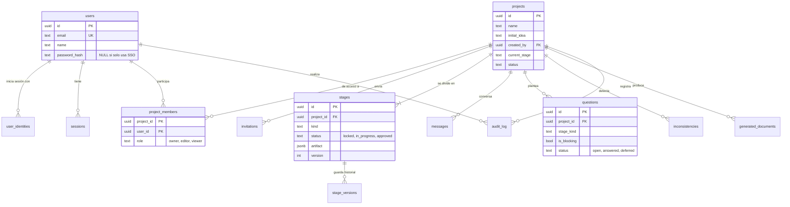

# Modelo de datos de Ideator

Fuente de verdad: `backend/src/db/migrations/001_init.sql`. Este documento lo explica.

## Cómo cubre cada requisito del enunciado

| Requisito | Dónde se resuelve |
|---|---|
| Proyectos privados por defecto | Solo se accede a un proyecto si existe una fila en `project_members` |
| Colaboración con permisos | `project_members.role`: `owner`, `editor` o `viewer` |
| SSO | `user_identities` enlaza un usuario con su identificador en el proveedor externo |
| Trazabilidad | `audit_log`, más `created_by` en `stage_versions` y `updated_by` en `stages` |
| Concurrencia | `stages.version`: se guarda solo si la versión enviada coincide; si no, 409 |
| Preguntas bloqueantes | `questions.is_blocking`; una bloqueante no puede quedar en `deferred` |
| Consistencia entre etapas | `inconsistencies`, con severidad `critical` o `warning` |
| Cinco arquitecturas | `architecture_templates` |
| Dos documentos Markdown | `generated_documents`, tipos `product_spec` y `architecture` |

## Decisiones

- **Una fila por etapa y proyecto.** El contenido de la etapa es un JSON en `stages.artifact`,
  con el formato definido en `backend/src/contracts/artifacts.ts`. Evita crear decenas de
  tablas para entidades, endpoints y pantallas del producto que se está ideando.
- **Historial inmutable.** Cada guardado copia el artefacto a `stage_versions` con su autor y
  si lo propuso la IA o lo editó una persona.
- **Tokens con hash.** `sessions` e `invitations` guardan el hash del token, nunca el valor.
- **Listas de valores con CHECK** en vez de tipos ENUM, porque son más simples de migrar.

## Reglas que el backend debe aplicar

1. Una etapa pasa a `in_progress` solo cuando la anterior está `approved`.
2. No se puede aprobar una etapa con preguntas bloqueantes abiertas.
3. Editar una etapa aprobada vuelve a `in_progress` esa etapa y las posteriores.
4. No se generan documentos si hay bloqueantes abiertas o inconsistencias `critical` sin resolver.
